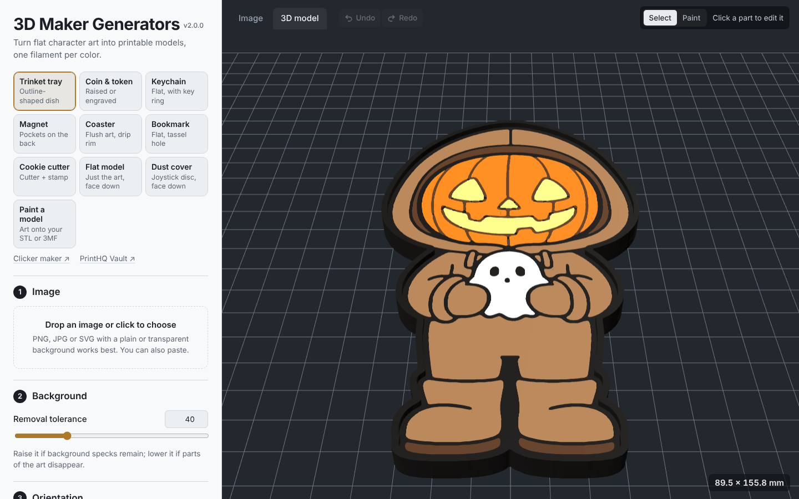
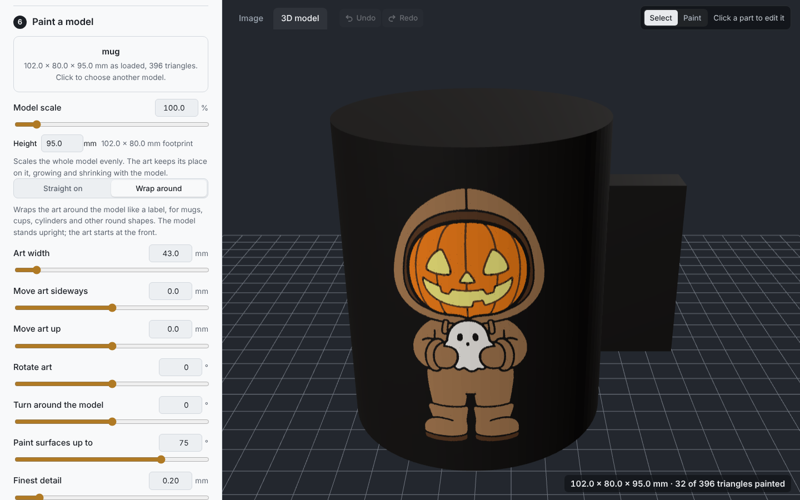

# 3D Maker Generators

Turn flat character art into multicolor, 3D-printable models: one part per color, ready for a multi-filament printer. Or paint the art onto a model you already have.

<p align="center">
  
  
</p>

| Generator | What it makes |
|---|---|
| Trinket tray | A dish that follows the outline of the art, with a wall around it |
| Coin & token | Round token with the art raised, engraved or inlaid |
| Keychain | Flat charm with a key-ring tab, in outline, circle, square, star, cloud or hexagon shapes |
| Magnet | Flat charm with pockets for round magnets (open, or hidden with a print pause) |
| Coaster | Flush art with a raised drip rim and an optional cork/felt recess |
| Bookmark | Rounded rectangle with a tassel hole, printed face down |
| Cookie cutter | A cutter that follows the art's outline, plus a matching mirrored stamp |
| Flat model | Just the art as a flat piece, printed face down |
| Dust cover | Joystick dust-cover disc (41.5 mm, 9 mm center hole, 1 mm thick by default), printed face down |
| Paint a model | Load your own STL or 3MF and paint the art onto it, straight onto one side or wrapped around a round model. The shape is not changed; the art is saved as Orca color painting on your filament slots |

Shared features: background removal, automatic color detection with merge/paint/select tools, SpoolmanDB filament matching, an optional text layer, filler shapes (stars, hearts, dots) for empty space, a minimum line width so thin outlines print cleanly, undo/redo, and face-down export.

## Paint a model

Load your own STL or 3MF and the art is painted onto it. The shape is never changed: the art is saved as Orca color painting (the same data Orca's color painting tool makes), on the filament slots you choose, so you can touch it up in Orca afterwards.

- **Straight on** projects the art onto one side (front, back, left, right, top, or the direction the 3D view is facing). Good for flat and gently curved faces.
- **Wrap around** wraps it round a model like a label: mugs, cups, cans, vases. The wrap follows the body, not a handle or spout, and is picked automatically for round models.
- **Text only** works too: type a name or message with no image (straight, or curved along the top or bottom).
- **Click to place**: press *Click the model to place the art* and click the spot in the 3D view where the middle of the art should go.
- **Lay on face**: click a face in the 3D view to turn the model so it sits flat on the plate on that face, like the slicer's tool.
- Scale the model, then size, move, rotate and turn the art. Surfaces turned too far away, or hidden behind another part, stay unpainted. *Finest detail* sets how sharp the color edges are (0.2 mm by default).

STEP files aren't read; export them as STL or 3MF first.

## Three ways to run it

**In a browser.** `dist/maker-generators.html` is a single file. Open it in any modern browser.

**As an OrcaSlicer 2.5 plugin.** Install `dist/maker_generators_orca_plugin.py` from ☰ → Plugins → Install plugin and activate it. It adds a *3D Maker Generators* tab to the top bar (and a floating panel in Speed Dial). It reads the filaments loaded in Orca, lets you match each color to a slot, and **Send to plate** drops the model on the plate with every part already on its filament slot. If the plate already has objects, choose *Import geometry only* when Orca asks.

**As a Windows app.** `MakerGenerators-Setup-x.y.z.exe` installs per user (no admin). Needs the Microsoft Edge WebView2 runtime, which current Windows 10/11 already has.

Prebuilt files are on the [Releases](../../releases) page.

### Orca filament slots outside the plugin

*Download for Orca Slicer* writes a 3MF whose `Metadata/model_settings.config` puts each part on a filament slot. It carries no printer or filament settings, so Orca keeps your presets.

## Building

```sh
python3 tools/build.py            # web + plugin + desktop resources
python3 tools/build.py web        # just one target
npm install && npm test           # geometry checks: every generator builds closed, printable solids
```

Outputs land in `dist/`. Source lives in `src/`:

- `src/app.html`: the interface (placeholders `/*CORE*/` and `/*SPOOLMANDB*/` are filled in at build time)
- `src/core.js`: all geometry: image → color regions → watertight meshes, plus the STL/3MF writers
- `plugin/plugin_template.py`: the OrcaSlicer plugin; the built page is embedded in it
- `desktop/`: Neutralino config, icon and NSIS installer script

### Windows app

```sh
python3 tools/build.py desktop
cd desktop/app
npx @neutralinojs/neu@11.8.0 update
npx @neutralinojs/neu@11.8.0 build --embed-resources
cd .. && makensis installer.nsi    # → dist/MakerGenerators-Setup-<version>.exe
```

The portable app is `desktop/app/dist/MakerGenerators/MakerGenerators-win_x64.exe`.

The version lives in the `VERSION` file. `tools/build.py` stamps it into the page, the plugin, `desktop/neutralino.config.json`, `desktop/installer.nsi` and `package.json`, so change it there and rebuild.

## Printing tips

- Face-down models (bookmarks, flat models): turn on Z-hop (0.4 mm) so travels don't scratch the back; ironing the top surface smooths it further.
- Keep *Minimum line width* at about twice your nozzle width (0.8 mm for a 0.4 mm nozzle).
- Painted models: the colors are only as sharp as the layer lines and nozzle allow. When the art is on a top surface (a bowl floor, a lid), a narrower, slower top surface helps a lot: tested on a Snapmaker U1 with top surface line width 0.32 mm and top surface speed 30 mm/s, and the eyes, smile and fine fur spikes came out crisp. On side walls (a mug), a smaller layer height gives cleaner edges.
- Painted models change filament many times, so expect a few strings between colors; a quick pass with a heat gun or lighter cleans them up.
- Cookie cutters: print lip-down without supports; use a food-safe filament and treat FDM cutters as hand-wash items.

Made by G-Tech3D / Geletka Tech. Released under the [MIT License](LICENSE); bundled third-party files keep their own licenses (see `vendor/README.md`).
